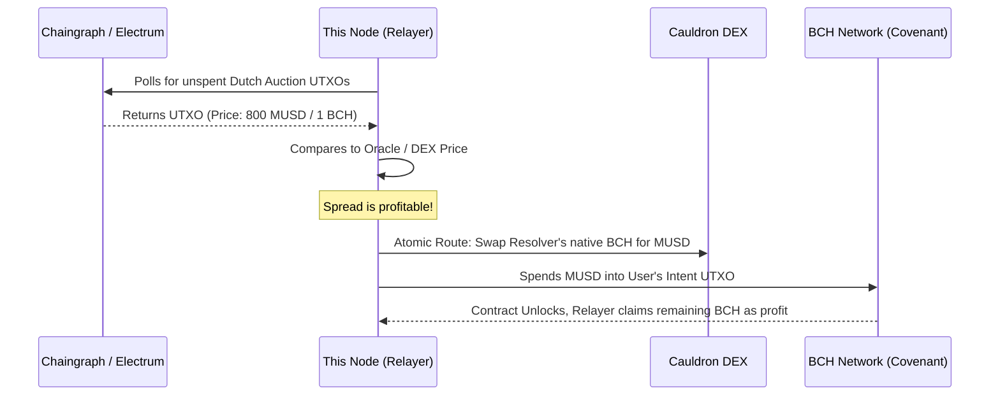

# Intents-Swaps: CashToken Reference Resolver Node

[](../docs/reviewers-guide/01-protocol-overview.md)
[](#license)

This repository contains the **Node.js Reference Implementation of a Decentralized Resolver (Solver)** engine responsible for facilitating **Same-Chain Trades** (Limit Orders and Dutch Auctions) entirely on the Bitcoin Cash network using CashTokens (e.g., BCH -> MUSD).

### Related Repositories
This is the off-chain execution engine for the Same-Chain architecture. It actively monitors and interacts with:
* **[contracts-bch-swap](../contracts-bch-swap)**: The Bitcoin Cash smart contracts enforcing the Limit Order and Dutch Auction covenants via Introspection.

## Architecture & Execution Flow

Unlike the Cross-Chain Resolver, which must synchronize state across multiple blockchains using HTLCs, the **CashToken Resolver** functions like an arbitrage or MEV bot operating strictly on Bitcoin Cash UTXOs.



### Core Responsibilities
1. **UTXO Polling**: Continuously queries the indexer for unspent outputs locked into the specialized `Swap.cash` or `DutchAuction.cash` covenants.
2. **Atomic Route Execution**: As a Dutch Auction UTXO decays its required payout price over time, the Resolver calculates profitability. It can craft a *single atomic transaction* that sources liquidity from AMMs like **Cauldron DEX**, buys the required MUSD, and fills the User's covenant.
3. **Price Execution**: Constructs the exact unlocking transaction bridging its own inventory to satisfy the covenant, claiming the spread remainder as profit using `OP_TXOUTPUTVALUE` constraints.

## 🛠️ Installation & Setup

1. **Prerequisites**
   * Node.js (v18+)
   * Funded BCH Chipnet Wallet (e.g. from `tbch.googol.cash`)

2. **Install Dependencies**
   ```bash
   npm install
   ```

3. **Configuration**
   * Copy `.env.example` to `.env` (if applicable).
   * Configure your `PRIVATE_KEY` and ensure `NETWORK=chipnet`.

4. **Run the Resolver**
   ```bash
   npm start
   ```
   The node will begin scanning the network for profitable covenant trades.

## Future-Proofing & Integrations

The CashTokens standard makes this protocol **token-agnostic**. The Resolver engine is built to fulfill intents for *any* minted asset on Bitcoin Cash without needing bespoke smart contract upgrades.

**Update (2026-07-04):** the **"Layla" upgrade** — which shipped Bounded Loops (`OP_BEGIN`/`OP_UNTIL`), Pay-to-Script, Functions, and Bitwise operations — activated 2026-05-15 and is live today, not a future upgrade. See `docs/future/` for concrete designs (partial fills, TWAP) that these primitives now enable.

---

## 📜 License

**Copyright (c) 2026 Intents-Swaps. All Rights Reserved.**
This software and associated documentation files are proprietary and confidential. No part of this repository may be copied, reproduced, distributed, or modified without explicit written permission.

*Part of the Intents Swap Protocol Ecosystem — Bringing Intent-based DeFi to Bitcoin Cash.*
