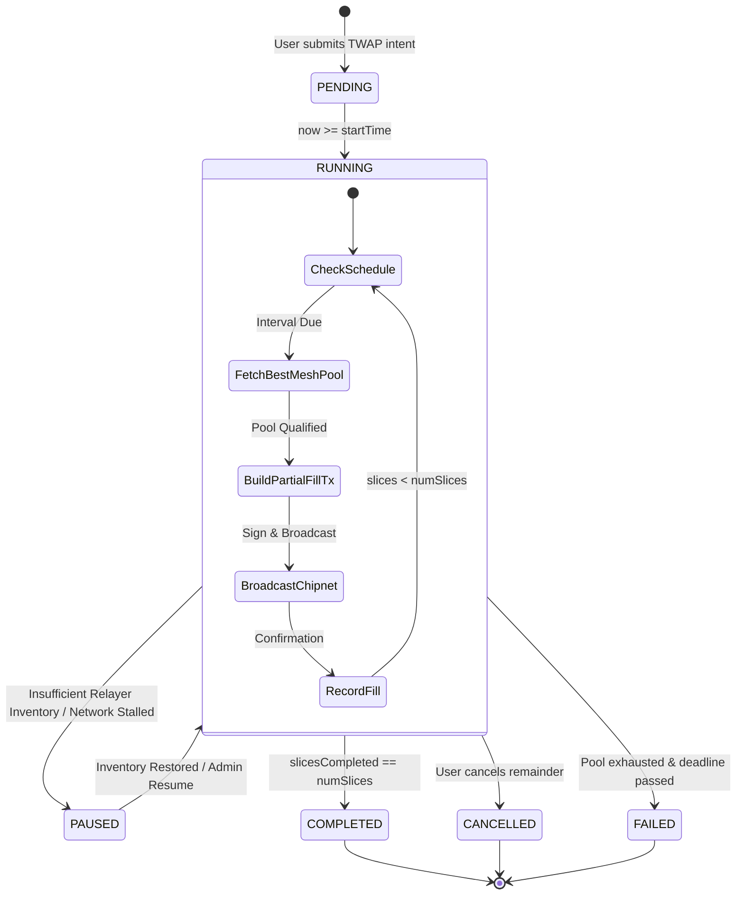

# 01 — Relayer TWAP Architecture & State Engine

## 1. TWAP Intent Model in Relayer

In `cashtoken-relayer`, parent TWAP requests are modeled as multi-stage intents stored in an append-only JSON/SQLite store with in-memory indexes.

### Intent Schema (`TwapStoredIntent`)

```typescript
export interface TwapStoredIntent {
  // ── Identification ────────────────────────────────────────────────────────
  id:                 string;         // UUID v4
  creatorPkh:         string;         // 20-byte hex maker/taker PKH
  creatorCashAddr:    string;         // e.g. bchtest:qq...
  
  // ── Asset Pair ────────────────────────────────────────────────────────────
  side:               'BUY' | 'SELL'; // BUY BCH (sell tokens) or SELL BCH (buy tokens)
  tokenCategory:      string;         // 32-byte hex CashToken category ID
  totalAmountIn:      string;         // Stringified bigint of total input tokens
  minTotalAmountOut:  string;         // Stringified bigint of total output guarantee
  
  // ── Time & Slicing Configuration ──────────────────────────────────────────
  numSlices:          number;         // e.g. 10 slices
  sliceAmountIn:      string;         // totalAmountIn / numSlices
  intervalSec:        number;         // Delay between slices (e.g. 60 seconds)
  startTime:          number;         // Unix timestamp (seconds)
  deadline:           number;         // startTime + (numSlices * intervalSec) + slackSec
  
  // ── Execution State ───────────────────────────────────────────────────────
  status:             'PENDING' | 'RUNNING' | 'PAUSED' | 'COMPLETED' | 'CANCELLED' | 'FAILED';
  slicesCompleted:    number;
  accumulatedAmountIn:  string;
  accumulatedAmountOut: string;
  totalFeesPaidSats:  string;
  
  // ── Slice Execution History ───────────────────────────────────────────────
  sliceFills:         TwapSliceRecord[];
  
  // ── Timestamps & Metadata ─────────────────────────────────────────────────
  createdAt:          number;
  updatedAt:          number;
}

export interface TwapSliceRecord {
  sliceIndex:         number;         // 0-indexed slice
  scheduledAt:        number;         // Expected execution timestamp
  executedAt:         number;         // Actual on-chain timestamp
  txid:               string;         // BCH transaction hash
  covenantAddress:    string;         // StrategyCovenant address consumed
  covenantUtxoSpent:  string;         // txid:vout
  amountIn:           string;
  amountOut:          string;
  relayerFeeSats:     string;
  makerFeeSats:       string;
  effectivePrice:     number;
}
```

---

## 2. Relayer State Machine



---

## 3. The Patient Scheduling Pattern

The relayer implements the **Patient Scheduling Engine** (similar to `DutchAuctionScheduler.ts`):

1. **Jitter & Slippage Control**:
   - The scheduler evaluates the market conditions 5 seconds prior to the scheduled slice interval.
   - If the current best available pool spread is wider than `maxSpreadBps`, the slice is deferred for `deferWindowSec` (e.g. 15s) to allow new maker liquidity to enter.

2. **Covenant Nonce Tracking**:
   - Because each slice recreation produces a new covenant UTXO (`vout: 0`), the relayer tracks the new outpoint immediately without waiting for standard block confirmations (using Bitcoin Cash 0-conf chained transactions).
   - This allows slices to execute reliably even at sub-minute intervals (e.g. 10s, 30s).

3. **Fallback Routing**:
   - If a target `StrategyCovenant` pool is partially filled by an external trader between slices, the scheduler dynamically re-routes the next slice to the next best pool indexed by MeshServer.
