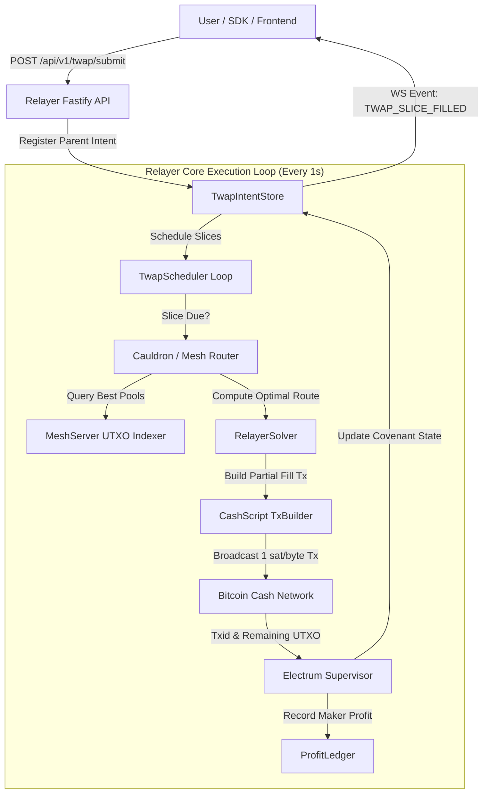

# ⏱️ CashToken Relayer: TWAP Execution Engine & Mesh Protocol Integration

> **Algorithmic Time-Weighted Average Price (TWAP) Order Execution Engine for CashToken Relayer against BCHMesh Liquidity Covenants**

---

## 📌 Executive Summary

The **CashToken Relayer TWAP Engine** enables high-volume traders, DAOs, and algorithmic funds to execute large orders on Bitcoin Cash without market impact or front-running vulnerabilities.

By leveraging BCH's **UTXO model**, **flat 1 sat/byte fees**, and **BCHMesh Strategy Covenants**, the relayer breaks down large parent intents into time-sliced micro-fills. These slices are routed across active `StrategyCovenant`, `DutchDecayStrategyCovenant`, and `OracleStrategyCovenant` UTXOs with automated inventory cycling and profit ledgering.

---

## 📚 Documentation Index

| Document | Focus Area | Description |
| :--- | :--- | :--- |
| **[01. Relayer TWAP Architecture](./01-relayer-twap-architecture.md)** | Core Bot & State Engine | TWAP Intent data structures, state machine, persistence, and scheduling queue |
| **[02. BCHMesh Fill Execution](./02-bchmesh-fill-execution.md)** | On-Chain Covenant Interaction | Multi-slice transaction building, UTXO introspection, and partial fill execution |
| **[03. Inventory & Profit Management](./03-inventory-and-profit-management.md)** | Financials & Risk Engine | Capital recycling, maker fee accrual, profit ledgering, and dust threshold safety |
| **[04. API & WebSocket Specification](./04-api-and-websocket-spec.md)** | Interface & Real-Time Events | Fastify HTTP endpoints, WebSocket streams, and frontend integration hooks |

---

## 🔄 Relayer Execution Architecture

---

## ⚡ Key Differentiators: BCH Relayer vs EVM Keepers

| Capability | EVM Keepers (Gelato / 1inch) | **CashToken Relayer + BCHMesh** |
| :--- | :--- | :--- |
| **Per-Slice Execution Cost** | $3.00 – $25.00 in gas | **~$0.002 (flat 1 sat/byte)** |
| **Intra-Slice Price Drift** | AMM bonding curve increases slippage | **Zero slippage** (fixed rational price covenants) |
| **Front-Running / Sandwiches** | High MEV risk in public mempool | **Zero MEV** (strict input UTXO spend rules) |
| **Capital Efficiency** | Locked collateral in smart contract | **UTXO auto-recreation directly to maker & taker** |
