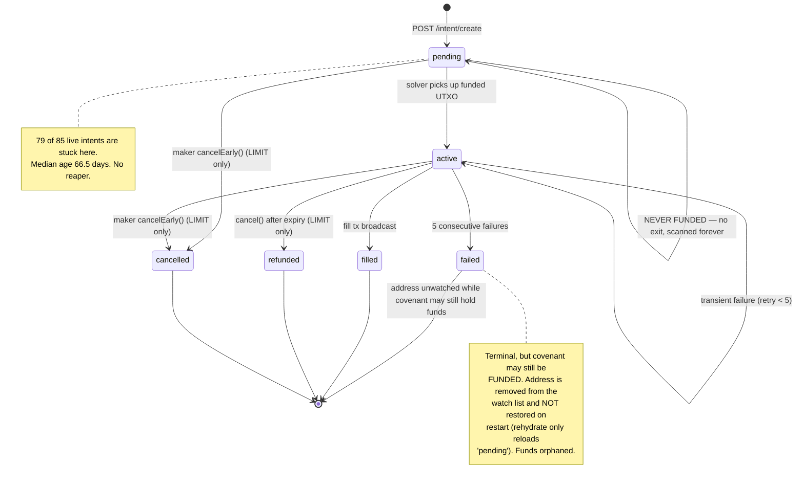
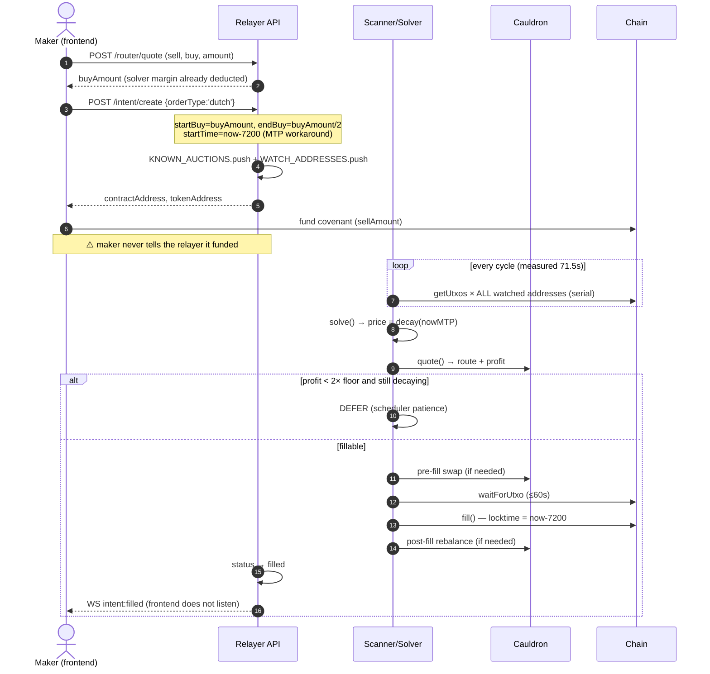
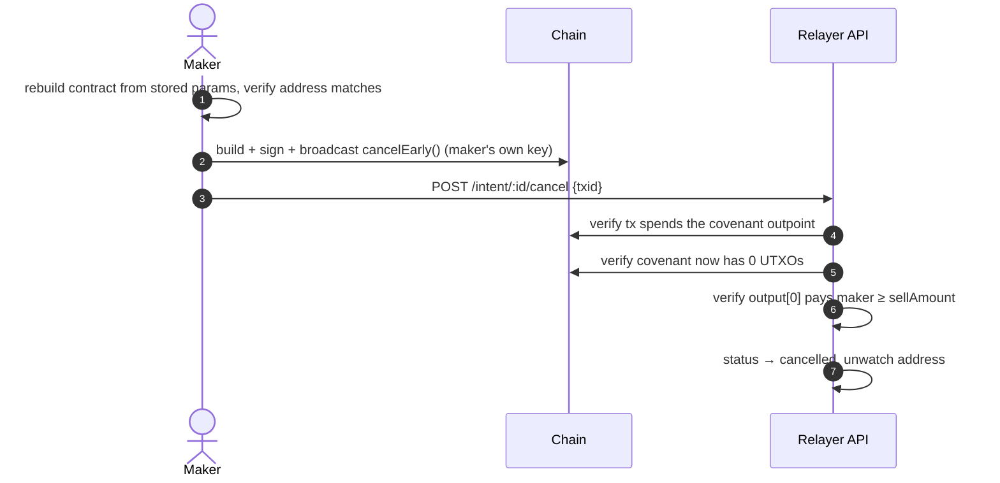
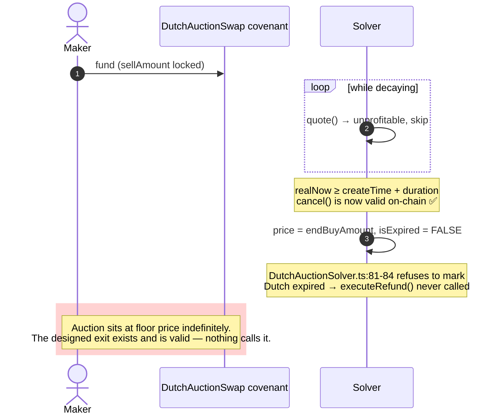
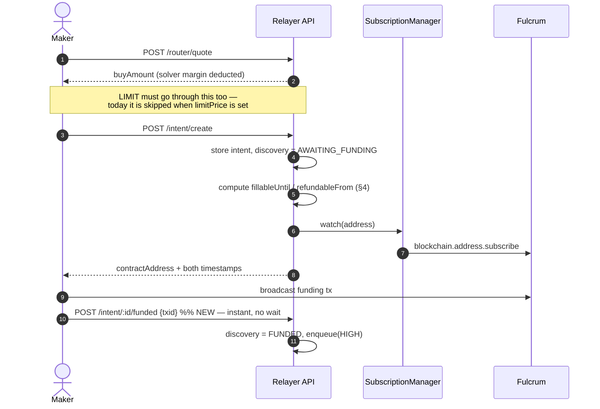
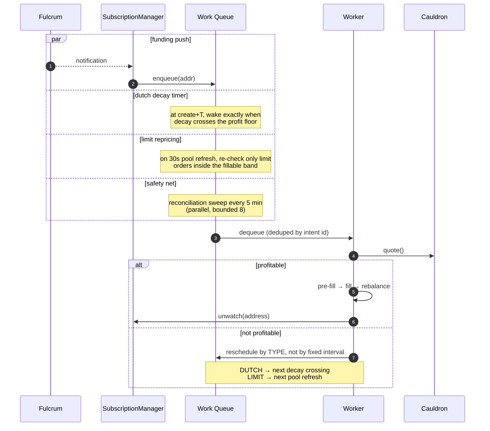
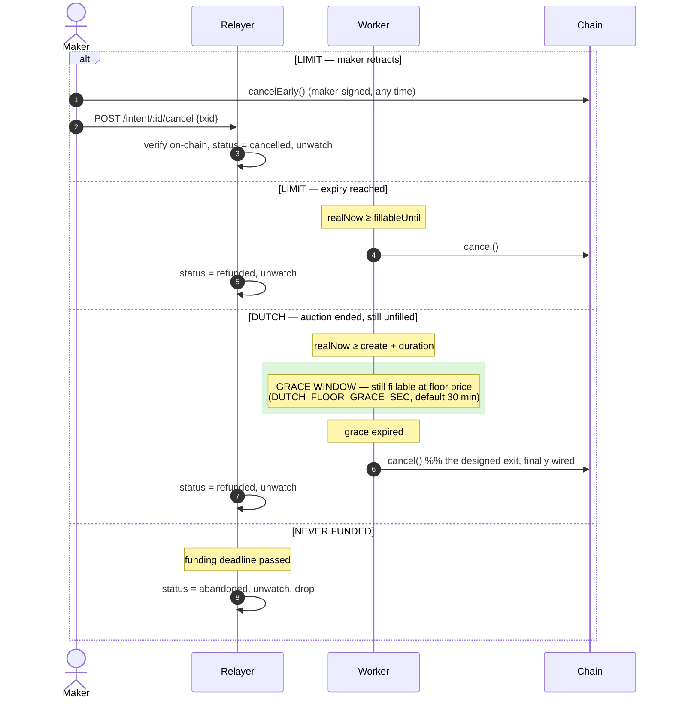

# Order Lifecycle, States & Flows — Limit vs Market

Status: audit + proposal · 2026-07-29 · companion to [intent-discovery-plan.md](./intent-discovery-plan.md)

> ## ⚠️ Historical — the timing analysis below is superseded
>
> This was the audit that drove the Phase 1/2 work. **G1–G8 have all shipped.** Kept for the
> reasoning, not as a description of current behaviour. Where it disagrees with the code, the
> code is right.
>
> **§3.3 and §4 are the parts to distrust.** They describe a world where the locktime was
> backdated by a hardcoded 7,200 s while deadlines were written in wall clock, so the backdate
> landed on top as a flat skew: a "1 hour" limit order was fillable for three (G3b), and the
> solver declined fills for ~2 h on orders the covenant would still have accepted (G3).
>
> Both are gone. Deadlines and locktimes are now written on **one clock**
> (`src/bot/CovenantClock.ts`):
>
> ```
> covenantNow = wallClockNow − BACKDATE
> ```
>
> Because it is one clock the backdate cancels out of every duration — an hour is an hour, and a
> Dutch auction decays in real seconds. The blackout is deleted. Median-time-past no longer sets
> any deadline; it is read from the chain only to *verify* the backdate still clears the real lag,
> since `covenantNow <= MTP` iff `BACKDATE >= (now − MTP)`.
>
> An intermediate design used MTP directly as the clock and is also gone — it fixed the skew but
> froze decay, because MTP advances when a block lands rather than when time passes. Measured on
> chipnet, a 600 s auction jumped 0/600 → 2232/600 in one step, handing makers the floor price.
> `test/clock_sanity.ts` guards against both failure modes.

## 1. Are Limit and Market treated the same?

**Mostly yes — and that's the problem.** "Market" in the UI maps to a Dutch auction
(`BCHSwapContext.tsx:666`: `orderType === 'limit' ? 'limit' : 'dutch'`). The two types
diverge at the edges but are **identical through the entire profitability and execution
core**, which is exactly where they should differ.

| Stage | Limit | Market (Dutch) | Same? |
|---|---|---|---|
| Contract | `LimitOrderSwap` | `DutchAuctionSwap` | — |
| Registry | `KNOWN_LIMIT_ORDERS` | `KNOWN_AUCTIONS` | two flat arrays, linear-scanned per UTXO |
| Price model | fixed `buyAmount` | linear decay `start→end` | **differs** |
| Price source (frontend) | user `limitPrice`, **no solver margin** | `/router/quote`, **margin deducted** | **differs** |
| Discovery | full serial sweep | full serial sweep | **same** |
| `CauldronRouter.quote()` | identical | identical | **same** — router cannot tell them apart |
| Scheduler | fills immediately | patience/defer logic | **differs** |
| Executor fill tx | identical shape | identical shape | **same** |
| `cancel()` (permissionless) | post-expiry ✅ | post-auction-end ✅ | both exist |
| `cancelEarly()` (maker) | ✅ | ❌ **missing** | **differs** |
| Relayer cancel API | ✅ | ❌ rejected (`index.ts:733`) | **differs** |
| Frontend cancel UI | ✅ main wallet only | ❌ rejected (`BCHSwapContext.tsx:997`) | **differs** |
| Expiry → refund | ✅ | ❌ **never expires** | **differs** |

The router receiving only `currentPrice` is *correct* design — but it means **nothing
downstream knows why an order isn't filling**, so both types get the same brute-force
re-scan treatment despite having completely different reasons to become fillable.

### The key insight for queueing

They need **different triggers, not different frequencies**:

- **Dutch/market** — price is a *deterministic function of time*. You can compute the exact
  instant profit crosses the floor and set one timer for it. `projectDutchPrice()` already
  exists in `DutchAuctionScheduler.ts`; inverting it gives the wake-up time. No polling.
- **Limit** — price is *fixed*. Fillability changes only when the **market** moves, so the
  trigger is the 30 s Cauldron pool-cache refresh, not a clock. Orders far out of the money
  can be skipped with a cheap band check before any route search.

Today both are driven by the same O(N) Electrum sweep, which is the wrong trigger for both.

## 2. State machine audit

### Declared vs actually reachable

`IntentStatus` (`intentStore.ts:9`) declares seven states. Six are written:

| State | Written at | Reachable? |
|---|---|---|
| `pending` | `index.ts:659` (create) | ✅ |
| `active` | `index.ts:1307`, `1343` | ✅ |
| `filled` | `index.ts:1357` (`markIntentDone`) | ✅ |
| `refunded` | `index.ts:1357` (`markIntentDone`) | ✅ |
| `failed` | `index.ts:1343` (5 consecutive failures) | ✅ |
| `cancelled` | `index.ts:795` (maker cancel API) | ✅ |
| **`expired`** | **nowhere** | ❌ **dead state** |

`expired` appears in the type union, the `/intents` query enum (`index.ts:462`), and the doc
comment ("past expiry, waiting for MTP to catch up") — but **no code path assigns it**. The
live store holds 7 intents in this state; they predate the current code. The condition it
describes is real and is currently *invisible* (see G3).

Missing entirely: any state for **"created but never funded"** — the cause of the 79 zombies.

### Current state diagram



## 3. Flows

### 3.1 Market (Dutch) — happy path



### 3.2 Limit order — happy path

Identical from `solve()` onward, except price is fixed and the scheduler never defers:

```mermaid
sequenceDiagram
    autonumber
    actor M as Maker (frontend)
    participant R as Relayer API
    participant S as Scanner/Solver
    participant C as Cauldron

    M->>M: limitPrice defaults to currentMarketRatio<br/>(USD mid — NO solver margin)
    Note over M: /router/quote is SKIPPED when limitPrice is set<br/>(BCHSwapCard.tsx:234)
    M->>R: POST /intent/create {orderType:'limit', expiryTime}
    R->>R: KNOWN_LIMIT_ORDERS.push + WATCH_ADDRESSES.push
    M->>C: fund covenant

    loop full sweep every cycle
        S->>S: solve() → price = buyAmount (fixed)
        S->>C: quote()
        alt profit ≥ floor
            S->>C: fill() immediately (no patience logic)
        else profit < floor
            S->>R: recordSkipReason(unprofitable_spread)
            Note over S: re-checked by brute-force sweep,<br/>not by pool-change trigger
        end
    end
```



Because the limit price is set at USD mid with no margin, `profit ≈ 0 < 1500 sat floor` —
so the common case is the lower branch, forever.

### 3.3 Limit expiry → refund, and the self-imposed blackout

`tx.locktime` must be ≤ MTP for a node to accept the tx, and MTP lags wall clock by ~2 h.
So the covenant's real fill window runs to `expiryTime + 7200`, and `cancel()` becomes valid
at exactly that instant (see §4 — the windows are complementary, there is no on-chain gap).
The blackout below is the **solver's own choice**, not a consensus constraint.

```mermaid
sequenceDiagram
    autonumber
    participant S as Solver
    participant BCH as Chain
    participant R as Relayer store

    Note over S: nowReal < expiryTime
    S->>S: fillable ✅

    rect rgb(255, 240, 200)
        Note over S,R: BLACKOUT — nowReal ≥ expiry, nowMTP < expiry (~2 hours)
        S->>S: solve() returns null (DutchAuctionSolver.ts:114-118)
        Note over S,BCH: ⚠️ the covenant WOULD still accept fill() here —<br/>locktime (realNow−7200) is still < expiryTime.<br/>The solver declines voluntarily.
        R->>R: status stays 'pending'/'active' — no 'expired'
        Note over R: address still scanned every cycle;<br/>maker sees no explanation
    end

    Note over S: nowMTP ≥ expiryTime
    S->>S: isExpired = true
    S->>BCH: cancel() — relayer pays the ~1500 sat fee
    R->>R: status → refunded
```

### 3.4 Maker early cancel — **limit only**



The relayer never holds the maker's key — verification only. Good design. **But this path
does not exist for Dutch auctions at any layer.**

### 3.5 Dutch auction with no fill — the unwired exit

Dutch has no `cancelEarly()` **by design** (a committed auction). The intended exit is the
permissionless `cancel()` at `T + duration`. That path is simply never invoked:



The fix is not a new contract branch — it's wiring up the one that already exists, behind a
grace window so solvers still get their shot at the floor price first.

## 4. Timing math — the two windows

Both covenants compare against `tx.locktime`, which the executor sets to `realNow − 7200`
(the MTP workaround). Working that through changes the picture materially.

### Dutch — clean, no skew

`startTime = createTime − 7200` (`index.ts:612`), and `cancel()` requires
`tx.time ≥ startTime + duration`:

```
realNow − 7200  ≥  (createTime − 7200) + duration
realNow         ≥  createTime + duration          ← the −7200 cancels out
```

**A Dutch auction is refundable exactly `duration` seconds after creation, in real time.**
No MTP dead zone. `fill()` only requires `locktime ≥ startTime`, which is always true.

### Limit — skewed by +2h, but the windows are complementary

`expiryTime = createTime + preset` (wall clock, no offset — `BCHSwapCard.tsx:417`):

| Branch | Requirement | Holds while |
|---|---|---|
| `fill()` | `locktime < expiryTime` | `realNow < createTime + preset + 7200` |
| `cancel()` | `tx.time ≥ expiryTime` | `realNow ≥ createTime + preset + 7200` |

They meet at exactly the same instant — **there is no consensus-level gap.** Two
consequences:

1. **The maker's chosen expiry is silently +2h on-chain.** A "1 hour" limit order is
   fillable for 3 hours.
2. **The 2-hour dead zone is self-imposed, not consensus-imposed.** The contract would
   happily accept a fill throughout; `DutchAuctionSolver.ts:114-118` voluntarily returns
   `null`. The relayer is declining fills on orders that are still perfectly fillable.

## 5. Gaps

**Note on Dutch `cancelEarly()`:** its absence is *by design* — a Dutch auction is a
commitment. Letting a maker retract mid-decay would leave solvers holding pre-fill
inventory they acquired against an order that vanished. The escape hatch is the
permissionless `cancel()` at `T + duration`, which is why that path must actually be wired
up (G1 below).

| # | Gap | Severity | Evidence |
|---|---|---|---|
| **G1** | **Dutch `cancel()` is never triggered.** The design relies on it as the maker's only exit, but `DutchAuctionSolver.ts:81-84` deliberately never sets `isExpired` for Dutch, so a fully-decayed unfilled auction sits at floor price forever and the maker is never refunded. | **HIGH — funds** | `DutchAuctionSolver.ts:81`, `DutchAuctionExecutor.ts:65` |
| **G2** | **`failed` orphans funded covenants.** After 5 failures the address is dropped from `WATCH_ADDRESSES`, and `rehydrateRegistry()` only restores `pending` — so it never returns, even across restarts. Combined with G1, a failed Dutch order is unrecoverable. | **HIGH — funds** | `index.ts:1350`, `index.ts:814` |
| **G3** | **Self-imposed 2-hour fill blackout on limit orders.** The covenant still accepts fills, but the solver returns `null` for ~2h between wall-clock expiry and MTP catch-up. Revenue left on the table, order stays `pending` with no explanation, address keeps burning scan budget. | MEDIUM | `DutchAuctionSolver.ts:114-118`, §4 |
| **G3b** | **Maker's chosen expiry is silently +2h on-chain.** A "1H" limit order is fillable for 3h. Nothing surfaces this. | MEDIUM | §4 |
| **G4** | **No `abandoned` state / no reaper** for never-funded intents. | MEDIUM — perf | 79 of 85 live intents |
| **G5** | **Refunds are relayer-funded** (~1500 sats each) with no reimbursement; a griefing vector at scale. | LOW-MED | `DutchAuctionExecutor.ts:400-422` |
| **G6** | **`expired` is dead code** — declared, queryable, documented, never assigned. | LOW | audit above |
| **G7** | **Address-keyed status lookup can collide.** Contract addresses are deterministic; two identical orders created in the same second yield one address and two records. `find()` resolves only the first. | LOW | `index.ts:1302`, `1365` |
| **G8** | **Both order types share one discovery trigger** despite needing different ones (time-deterministic vs market-driven). | MEDIUM — perf | §1 |

## 6. How the whole flow should work

Four settled semantics drive everything below:

| | Limit | Market (Dutch) |
|---|---|---|
| Maker may retract early | **yes** — `cancelEarly()`, any time | **no** — committed auction |
| Permissionless refund | `cancel()` at `expiryTime` (= create + preset + 2h real) | `cancel()` at `create + duration` |
| Price changes because | **the market moves** | **the clock moves** |
| Re-evaluation trigger | pool-cache refresh (30 s) | computed decay-crossing timer |

### 6.1 Order intake

Both types create a covenant, register it, and subscribe — no scanning.



### 6.2 Fill loop — one queue, three triggers



The reschedule branch is the whole point: **an unprofitable order must never cause another
Electrum round-trip.** It costs one timer entry or one cached-pool re-quote.

### 6.3 Exit paths



### 6.4 Decisions this encodes

1. **Wire up Dutch `cancel()` behind a grace window.** Valid from exactly `create + duration`
   (§4). Grace keeps the "fill at floor price" upside that `DutchAuctionSolver.ts:64-69`
   deliberately preserves, while guaranteeing the maker eventually gets funds back. Without
   this, a committed auction with no early-cancel has **no exit at all**.

2. **Delete the self-imposed limit blackout (G3).** Fill for the covenant's real window —
   `fill()` and `cancel()` are exactly complementary, so filling right up to
   `refundableFrom` is safe and strictly better than going dark for 2 hours.
   *Product call:* this means a "1H" order can fill at 2h50m. The alternative is honouring
   wall-clock expiry and idling — but then the order is dark, not cancelled, which serves
   nobody. Recommend filling the full window and labelling it honestly.

3. **Surface both timestamps.** Store `fillableUntil` and `refundableFrom` on the intent and
   return them from `/intents`. Fixes G3b — the maker stops being surprised that "1H" means
   3h on-chain.

4. **Route limit orders through `/router/quote`.** A limit price the maker picks is fine;
   defaulting it to USD mid with no solver margin guarantees it never fills. Reprice the
   presets off Cauldron with margin included, and keep a manual override.

5. **Set `expired` and add `abandoned`.** Gives every intent an honest terminal state and
   kills the 79 zombies.

6. **Never orphan a funded covenant (G2).** `failed` keeps its subscription; rehydrate
   restores any non-terminal intent, not just `pending`.

### 6.5 Where each order type costs solver budget

| Discovery state | Limit | Dutch | Recurring cost |
|---|---|---|---|
| `AWAITING_FUNDING` | subscription | subscription | **zero** |
| `FUNDED`, not fillable | 1 cached re-quote / 30 s | 1 timer entry | CPU only |
| `FUNDED`, fillable | worker slot | worker slot | the actual work |
| `ABANDONED` / terminal | unsubscribed | unsubscribed | **zero** |

Today all 85 intents sit in the top row and cost a 1.1 s Electrum round-trip each, every
cycle. Under this design the top row costs nothing and only the 6 genuinely-funded orders
consume anything.

## 7. Build order

| Step | Why first | Risk |
|---|---|---|
| 1. Wire Dutch `cancel()` + grace window | funds currently have no exit | low — contract branch already exists and is valid |
| 2. Stop orphaning funded covenants on `failed` | same | low |
| 3. Persistent Electrum connection + parallel sweep | 5× and 30× wins, unblocks everything | low |
| 4. Reap never-funded + gate rehydrate | removes 93% of scan load | low |
| 5. Delete limit blackout, surface both timestamps | revenue + honesty | low |
| 6. `SubscriptionManager` + `/intent/:id/funded` | removes polling entirely | medium — needs reconnect + `max_subs` headroom check |
| 7. Discovery states + typed work queue | the structural fix | medium |
| 8. Limit orders through `/router/quote` | fill rate | frontend change |

Steps 1-2 are fund safety and independent of everything else. Steps 3-5 are contained.
Steps 6-7 are the architecture. Step 8 is frontend.
