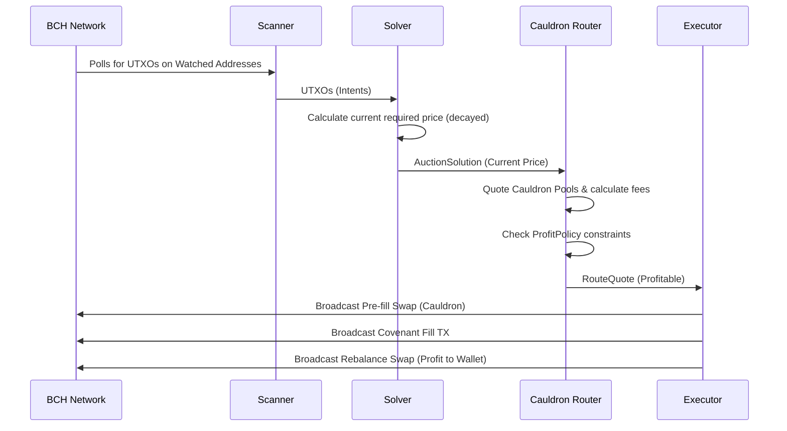

# CashToken Relayer: Architecture Overview

The CashToken Relayer is a high-performance MEV (Miner Extractable Value) bot operating on the Bitcoin Cash network. It functions as the "Solver" for the Intents-Swaps protocol, finding profitable arbitrage opportunities between User Intents (Limit Orders / Dutch Auctions) locked in covenants and on-chain liquidity (Cauldron DEX AMM) or its own inventory.

## 🧩 Core Architecture Flow

The relayer operates in a continuous asynchronous loop, processing through four main stages:

1. **Scanner** (`src/bot/Scanner.ts`)
2. **Solver** (`src/bot/DutchAuctionSolver.ts` / `LimitOrderSolver.ts`)
3. **Router** (`src/bot/CauldronRouter.ts`)
4. **Executor** (`src/bot/DutchAuctionExecutor.ts`)

## 🔍 The Scanner

The Scanner acts as the eyes of the relayer.
- It polls all addresses present in `ENV.WATCH_ADDRESSES`.
- `WATCH_ADDRESSES` are populated via the `.env` file, as well as dynamically rehydrated from `intents.json` when the server restarts.
- Uses `ElectrumNetworkProvider` to fetch all unspent UTXOs locked in these covenant addresses.

## ⚡ Concurrency

As of 2026-07-04, the bot processes up to `SOLVER_CONCURRENCY` (default 4) matched intents in parallel per scan cycle, instead of one at a time. Solver-wallet UTXO selection safety across concurrent fills is enforced by `src/bot/UtxoReservation.ts` — every coin-selection call site claims an outpoint the instant it's picked, before any broadcast, so two concurrent fills can never build conflicting transactions over the same input.

One caveat worth knowing: `CauldronRouter.ts`'s Cauldron-routed trades (`BCH_TO_TOKEN`, `TOKEN_TO_BCH`, `TOKEN_TO_TOKEN`, `INVENTORY_TO_TOKEN`) currently pass their *entire* available balance of the relevant currency to CashLab as trade inputs (not a bounded subset), so in practice only one such trade is ever in flight at a time — see `cashtoken-relayer/MILESTONES.md` for the tracked follow-up. `DIRECT` (inventory) fills, which select a bounded 1-2 UTXOs precisely, parallelize correctly today.
